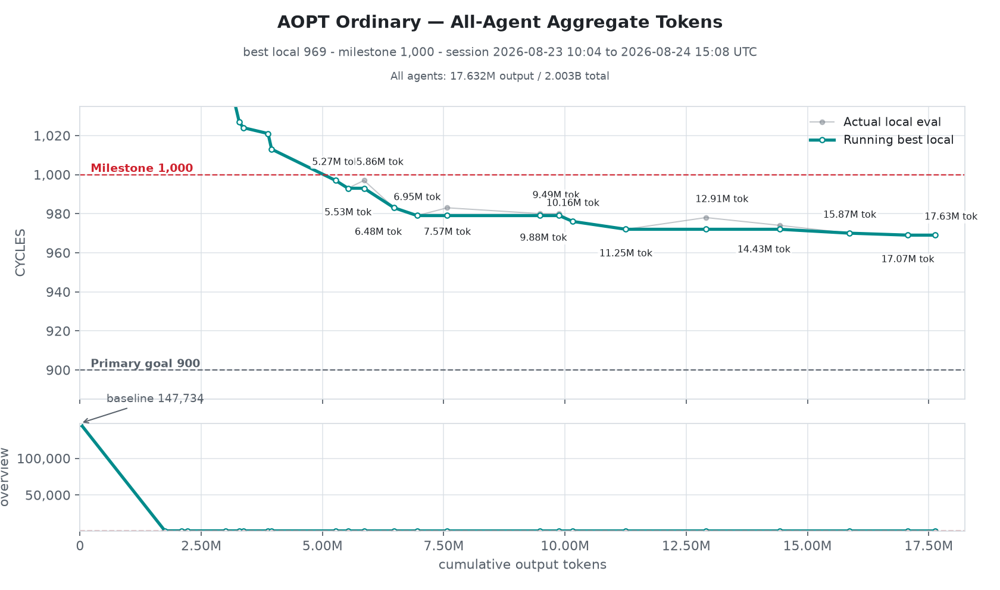
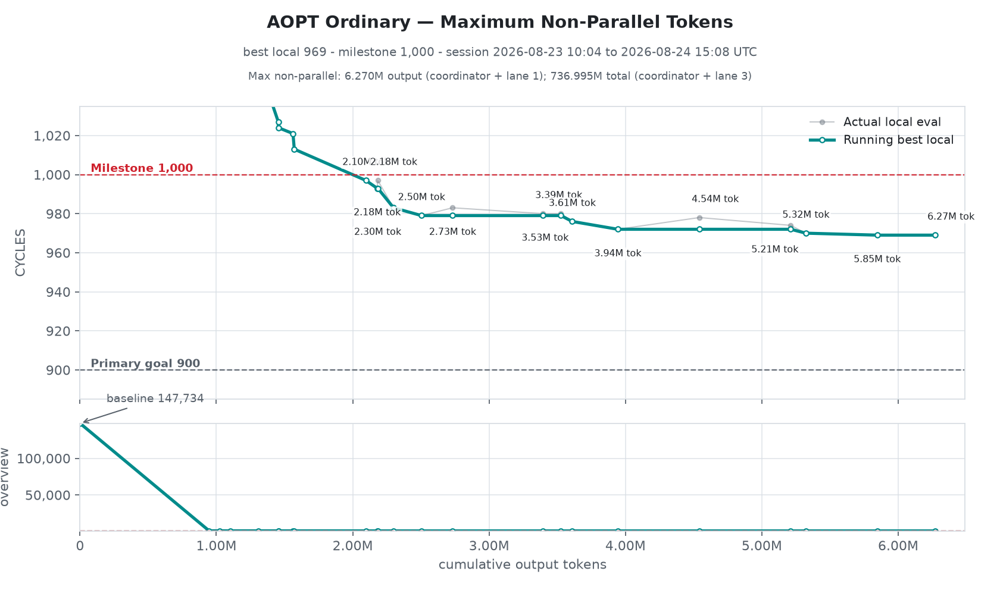

# parallel_flame_chase _(parallel-flame-chase-flow)_

Parallel Flame Chase for hmz: three report-driven lanes of alternating agents, with a Git PR variant.

Chase three leads at once. A coordinator plans three lanes; in each lane two actors take turns
in fresh sessions, and the lanes keep each other informed by report. The flow comes in two
shapes, one [hmz](https://github.com/humanfia/humanize) flow with a variant beside it:

| Flow | What reaches your tree |
| --- | --- |
| `parallel_flame_chase` | **Only lane 1 writes your tree.** Lanes 2 and 3 work on private copies, and what they find reaches lane 1 as a report and an artifact. |
| `parallel_flame_chase:git_pr` | **Every lane has a clone and opens pull requests**, and a pull request reaches `main` only when a measurement shows it is better. |

## Table of Contents

- [Background](#background)
- [Install](#install)
- [Usage](#usage)
  - [parallel_flame_chase](#parallel_flame_chase)
  - [parallel_flame_chase:git_pr](#parallel_flame_chasegit_pr)
  - [What ends it](#what-ends-it)
  - [Picking it up](#picking-it-up)
  - [Where a run keeps its data](#where-a-run-keeps-its-data)
- [Contributing](#contributing)
- [License](#license)

## Background

It is [flame_chase](https://docs.humanfia.ai/humanize/flows/flame-chase) three times over, with
a plan up front. The bundled `parallel-flame-chase` and `parallel-flame-chase-git-pr` skills
define the actor, report, artifact, checkpoint and resume protocol each shape's agents work
by. Both coordinate local work only: nothing in them releases, deploys, submits or sends
anything.

An ordinary `parallel_flame_chase` run on the AOPT task, a cycle-count optimisation, took it
from a 147,734-cycle baseline to 969 cycles:





## Install

You need [hmz](https://github.com/humanfia/humanize). In hmz, open `/flow`, go to
**Flowverses → official → parallel_flame_chase** and **Install** it. Both shapes come with
it, but only `parallel_flame_chase:git_pr` is listed where you pick a flow; run the ordinary
shape by naming it, `-f parallel_flame_chase`.

To run a release without installing it, name it by its git ref:

```sh
hmz exec -f git+https://github.com/humanfia/parallel-flame-chase-flow@v0.1.3#parallel_flame_chase ...
hmz exec -f git+https://github.com/humanfia/parallel-flame-chase-flow@v0.1.3#parallel_flame_chase:git_pr ...
```

## Usage

### parallel_flame_chase

```text
❯ $parallel_flame_chase get the solver under 10 s on every benchmark in bench/
```

```sh
hmz exec -f parallel_flame_chase \
    -a coordinator=codex/gpt-5.6-sol:max \
    -a lane_1_actor_a=claude/claude-opus-5:max,lane_1_actor_b=codex/gpt-5.6-sol:max \
    -a lane_2_actor_a=claude/claude-opus-5:max,lane_2_actor_b=codex/gpt-5.6-sol:max \
    -a lane_3_actor_a=claude/claude-opus-5:max,lane_3_actor_b=codex/gpt-5.6-sol:max \
    -p budget.duration=12h,budget.cost=500 "$(cat TASK.md)"
```

Use it when the task is open enough that three approaches are worth trying side by side, and
you have the budget for seven agents. If every lane should get a clone and compete through pull
requests instead, use [`parallel_flame_chase:git_pr`](#parallel_flame_chasegit_pr).

| Role | |
| --- | --- |
| `coordinator` | Plans the three lanes, once, and leaves the run. |
| `lane_1_actor_a` · `lane_1_actor_b` | Lane 1, taking turns. The only ones that write your tree. |
| `lane_2_actor_a` · `lane_2_actor_b` | Lane 2, taking turns, on a private copy. |
| `lane_3_actor_a` · `lane_3_actor_b` | Lane 3, taking turns, on a private copy. |
| `human` | You, filled in by hmz. Asked only to confirm copying a very large workspace. |

Every role may write anywhere its user can and use the web: lanes run your builds, tests and
evaluators, and publish what they make beside the workspace. Any backend can fill any role, and
none of them is run as a `/goal`. The `workspace` environment is the directory the run starts
in, and takes no `-e`.

| Param | Default | |
| --- | --- | --- |
| `rest_seconds` | `1.0` | Seconds the scheduler rests between passes, 0.05 to 60. |
| `resume_mode` | `auto` | `auto` picks up a compatible earlier run; `fresh` starts another. |
| `confirm_large_workspace_copies` | `false` | Ask before copying a very large workspace. Under `hmz exec` nobody answers, so the run stops before copying. |
| `workspace_file_warning_threshold` | `5000` | Files that make a workspace very large. |
| `workspace_copy_warning_threshold_bytes` | `1073741824` | Bytes of copies that make it very large (1 GiB). |

Reports are redelivered until the receiving lane completes a valid turn and acknowledges them.
All three lanes may use task-provided evaluators and attach an accepted candidate to a
`deliverable_ready` report; the runtime binds every candidate to hashed artifacts and keeps a
single-writer cross-lane board at `shared/leaderboard.json`, whose best is in every fresh lane
prompt. Submitting a candidate grants no right to integrate source or act remotely. The
[`_parallel_flame_chase`](parallel_flame_chase/_parallel_flame_chase/README.md) package
describes the runtime.

### parallel_flame_chase:git_pr

```text
❯ $parallel_flame_chase:git_pr get the solver under 10 s on every benchmark in bench/
```

```sh
hmz exec -f parallel_flame_chase:git_pr \
    -a orchestrator=codex/gpt-5.6-sol:max \
    -a lane_1_actor_a=codex/gpt-5.6-sol:max,lane_1_actor_b=claude/claude-opus-5:max \
    -a lane_2_actor_a=claude/claude-opus-5:max,lane_2_actor_b=codex/gpt-5.6-sol:max \
    -a lane_3_actor_a=claude/claude-opus-5:max,lane_3_actor_b=codex/gpt-5.6-sol:max \
    -p budget.duration=12h,budget.cost=500 "$(cat TASK.md)"
```

[`examples/git-pr.sh`](parallel_flame_chase/examples/git-pr.sh) spells every param out.

Use it when the task has a number to beat, such as a benchmark, a score or a size, and a
command that measures it. Nothing here asks a model whether a change is good: the measurement
decides. There is no reviewer. Its setup is fixed to the one that did best in a twelve-hour
Git PR Lite experiment: Report Share and deterministic, receipt-backed PR integration.

How a change reaches `main`:

1. A lane may keep many drafts, but only one pull request ready at a time. A ready pull request
   is frozen, and a newer one from the same lane replaces it.
2. The lane measures it with `pfc evaluate -- <command>`, which runs your evaluator on a clean
   tree and keeps a receipt of the result that cannot be changed. Large artifacts go through
   `pfc artifact put` rather than Git.
3. The lowest-cycle candidate is merged only if its receipt improves on `main`. The central
   repository's hook refuses a `main` that is not exactly the tree that was measured, with two
   exact parents, an allowed-path diff, a head-bound receipt and the matching `PFC-PR` trailer.

What lanes learn from each other is their reports, and the flow's own reports of what was
merged and what was refused.

| Role | |
| --- | --- |
| `orchestrator` | Plans the three lanes, once. |
| `lane_1_actor_a` · `lane_1_actor_b` | Lane 1, taking turns in fresh sessions, in a clone of its own. |
| `lane_2_actor_a` · `lane_2_actor_b` | Lane 2, the same. |
| `lane_3_actor_a` · `lane_3_actor_b` | Lane 3, the same. |
| `human` | You, filled in by hmz. Asked only to confirm copying a very large workspace. |

Any backend can fill any role. The lane actors may also write outside their clone, which is how
they push to the run's central repository.

| Param | Default | |
| --- | --- | --- |
| `rest_seconds` | `1.0` | Seconds the scheduler rests between passes, 0.05 to 60. |
| `resume_mode` | `auto` | `auto` picks up a compatible earlier run; `fresh` starts another. |
| `confirm_large_workspace_copies` | `false` | Ask before making the copies of a very large workspace. Under `hmz exec` nobody answers, so the run does not start. |
| `workspace_file_warning_threshold` | `5000` | Files that make a workspace very large. |
| `workspace_copy_warning_threshold_bytes` | `1073741824` | Bytes of copies that make it very large (1 GiB): the lanes' clones, the planning and integration trees, and the git objects. |

Five more params are fixed, so that a launch cannot turn the measured setup into a different
one: `git_pr_enabled` is `true`, and `global_knowledge_enabled`, `experiment_memory_enabled`,
`token_efficient_enabled` and `main_update_monitor_enabled` are `false`. SQLite/WAL is the live
truth, JSONL the audit stream, and JSON/Markdown disposable views; the
[`_parallel_flame_chase_git_pr`](parallel_flame_chase/_parallel_flame_chase_git_pr/README.md)
package describes the runtime.

### What ends it

**The [budget](https://docs.humanfia.ai/humanize/features/allowances), or you.** The lanes go
on for as long as the run does, so give it a `-p budget.duration=`. When it runs out, the turns under way
finish and are recorded, and the run stops. In either shape, a lane whose two turns in a
row fail is held until the objective is replanned; the others go on.

### Picking it up

Both shapes are resumable. `--resume` picks up the newest run in the workspace: the plan, the
copies or the central repository, the receipts, the artifacts, the reports and whose turn each
lane is on. `-p resume_mode=fresh` starts another run instead. For `parallel_flame_chase`, the
same task carries on where it stopped; `continue` reads `TASK.md` if there is one; and a
changed objective is planned again against a fresh copy of your tree, in the same run. See
[Picking a run up](https://docs.humanfia.ai/humanize/user/resuming).

Leave your source tree alone while a run holds it. Only one run may hold a source tree at a
time, whether of `parallel_flame_chase` or of `parallel_flame_chase:git_pr`: a second one
refuses to start.

### Where a run keeps its data

A run keeps its runtime data in a scratch directory of the workspace environment, under hmz's
home, named `parallel_flame_chase-<run-id>` or `parallel_flame_chase_git_pr-<run-id>`:

```text
<hmz home>/envs/<workspace>-<digest>/scratch/parallel_flame_chase-<run-id>-<digest>/
├── objective.md
├── private/lane-2/  private/lane-3/        # the private snapshots
└── shared/
    ├── planning-workspace/  planning-revisions/
    ├── reports/  artifacts/  checkpoints/  staging/
    └── leaderboard.json  state.json  manifest.json  workspace-map.json
```

A run that keeps a journal, as every `hmz exec` run of a resumable flow does, keeps this
directory for `--resume`. A run that keeps none, such as one called from a flow that is not
resumable, has it removed when it ends; what it wrote to your source stays.

## Contributing

Issues and pull requests are welcome. The flow is the `parallel_flame_chase/` directory; its
tests are in `tests/`. With [uv](https://docs.astral.sh/uv/):

```sh
uv sync
uv run ruff check
uv run ruff format --check
uv run pytest
```

CI runs the same on every pull request. A release is a `vX.Y.Z` tag on `main`; it reaches hmz
users once a `flows/parallel_flame_chase/X.Y.Z/flow.yaml` pointing at it is merged into
[humanfia/flowverse](https://github.com/humanfia/flowverse).

## License

[Apache-2.0](LICENSE) © Humanfia
